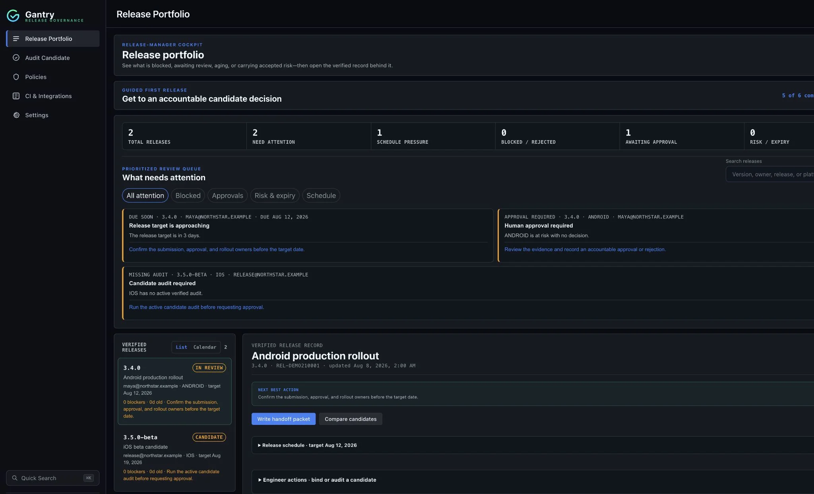

<div align="center">
  

# Gantry Community

**Local-first mobile release governance for iOS and Android.**

[Website](https://gantryapp.com/) ·
[Getting started](docs/getting-started.md) ·
[CLI reference](docs/cli-reference.md) ·
[GitHub Action](docs/github-action.md)

[](./LICENSE)
[](https://crates.io/crates/gantry-cli)



</div>

> This repository contains the source of Gantry Community 0.5.2, licensed under
> Apache-2.0. Active development continues privately.

## What Gantry is

Gantry checks the exact iOS or Android candidate you intend to ship, explains what is
blocking it, records who accepted the remaining risk, and exports a portable release
packet. It runs on your machine or in your CI, keeps its state in your repository, and
requires no Gantry account.

- Audits project source (Flutter, React Native, native iOS, native Android) and built
  IPA, AAB, and APK artifacts.
- Binds evidence, approvals, and waivers to an exact candidate: a Git commit and an
  artifact SHA-256.
- Produces a **Go**, **At Risk**, or **No-Go** decision that CI can enforce.
- Exports JSON, Markdown, and HTML release packets.
- Ships as a CLI, a GitHub Action, and a macOS desktop app, all backed by the same Rust
  core and public JSON schemas.

## Install

### Homebrew (macOS and Linux)

```bash
brew install trygantry/tap/gantry                 # CLI
brew install --cask trygantry/tap/gantry          # macOS desktop app
```

The desktop app is unsigned and not notarized. On first launch, Control-click Gantry in
Applications, choose **Open**, then confirm.

### Install script (macOS and Linux CLI)

The script downloads the CLI from the
[gantry-distribution releases](https://github.com/trygantry/gantry-distribution/releases),
verifies its SHA-256 checksum, and installs it to `~/.local/bin/gantry` without `sudo`:

```bash
curl --proto '=https' --tlsv1.2 -LsSf \
  https://raw.githubusercontent.com/trygantry/gantry/main/install.sh | sh
```

Pin a version or choose another directory with `GANTRY_VERSION` and
`GANTRY_INSTALL_DIR`:

```bash
curl --proto '=https' --tlsv1.2 -LsSf \
  https://raw.githubusercontent.com/trygantry/gantry/main/install.sh | \
  GANTRY_VERSION=0.5.2 GANTRY_INSTALL_DIR="$HOME/bin" sh
```

### Windows CLI

Run this in PowerShell. It installs to your user profile and does not need administrator
access:

```powershell
irm https://raw.githubusercontent.com/trygantry/gantry/main/install.ps1 | iex
```

### Prebuilt assets

CLI binaries, desktop DMGs, and checksums are attached to each release in
[trygantry/gantry-distribution](https://github.com/trygantry/gantry-distribution/releases).

### From crates.io

```bash
cargo install gantry-cli
```

Crates: [`gantry-cli`](https://crates.io/crates/gantry-cli) and
[`gantry-core`](https://crates.io/crates/gantry-core).

## Build from source

You need Rust 1.88 or newer. The CLI and core library have no GUI dependencies:

```bash
git clone https://github.com/trygantry/gantry.git
cd gantry
cargo build --release -p gantry-cli     # binary at target/release/gantry
cargo test -p gantry-core -p gantry-cli
```

The desktop app is a Tauri 2 application in `src-tauri/` with a plain JavaScript
frontend in `src/`. See [CONTRIBUTING.md](CONTRIBUTING.md) for desktop prerequisites.

## First useful result

From an iOS, Android, Flutter, or React Native repository:

```bash
gantry mobile detect
gantry init --mobile
gantry mobile audit
```

When the signed candidate exists, bind the decision to its exact bytes:

```bash
gantry mobile audit \
  --artifact build/app/outputs/bundle/release/app-release.aab \
  --ci
```

Gantry records the Git commit, artifact SHA-256, packaged identity and version,
signature-verification result, policy version, every finding, and the evidence still
required from a human or external system.

## What Gantry catches

- The source configuration and the packaged IPA, AAB, or APK disagree.
- The release uses the wrong bundle ID, version, SDK target, signing state, permission,
  privacy declaration, or production policy.
- Required tests, operational evidence, or accountable human review are missing.
- A waiver has expired or applies to a different candidate.
- Someone tries to approve a changed or unaudited artifact.

## Gate a release in GitHub Actions

```yaml
name: Gantry release gate
on: [pull_request]

jobs:
  gantry:
    runs-on: ubuntu-latest
    permissions:
      contents: read
      pull-requests: write
    steps:
      - uses: actions/checkout@v5
      - uses: trygantry/gantry@v1
        with:
          workspace: "."
          fail-on-no-go: true
          comment: true
```

See [docs/github-action.md](docs/github-action.md) for artifact-bound audits, durable
releases, packet uploads, and all inputs.

## Trust boundaries

- Local sign-off identities are declared identities. Use protected branches, code review,
  signed commits, or an external identity provider when authenticated identity is
  required.
- `gantry verify` detects changes to Gantry's local snapshot chain. It does not make Git
  history immutable.
- A local hook can be bypassed. Make `gantry validate --ci` a required check when the
  decision must be enforced.
- Gantry verifies the platform signature only when the matching tool is available
  (`codesign`, `apksigner`, or `jarsigner`). Unavailable verification is never reported
  as a pass.

## Documentation

- [Getting started](docs/getting-started.md)
- [Mobile release governance](docs/mobile-release-governance.md)
- [CLI reference](docs/cli-reference.md)
- [GitHub Action](docs/github-action.md)
- [User and administrator manual](docs/manual.md)
- [Architecture](docs/architecture.md)
- [JSON schemas](schemas/README.md)
- [Changelog](CHANGELOG.md)

## Contributing and security

See [CONTRIBUTING.md](CONTRIBUTING.md) and the [Code of Conduct](CODE_OF_CONDUCT.md).
Report vulnerabilities privately as described in [SECURITY.md](SECURITY.md). For anything
else, write to [hi@gantryapp.com](mailto:hi@gantryapp.com).

## License

Gantry Community is licensed under the [Apache License 2.0](LICENSE). See
[NOTICE](NOTICE) and [TRADEMARKS.md](TRADEMARKS.md) for attribution and name usage.
