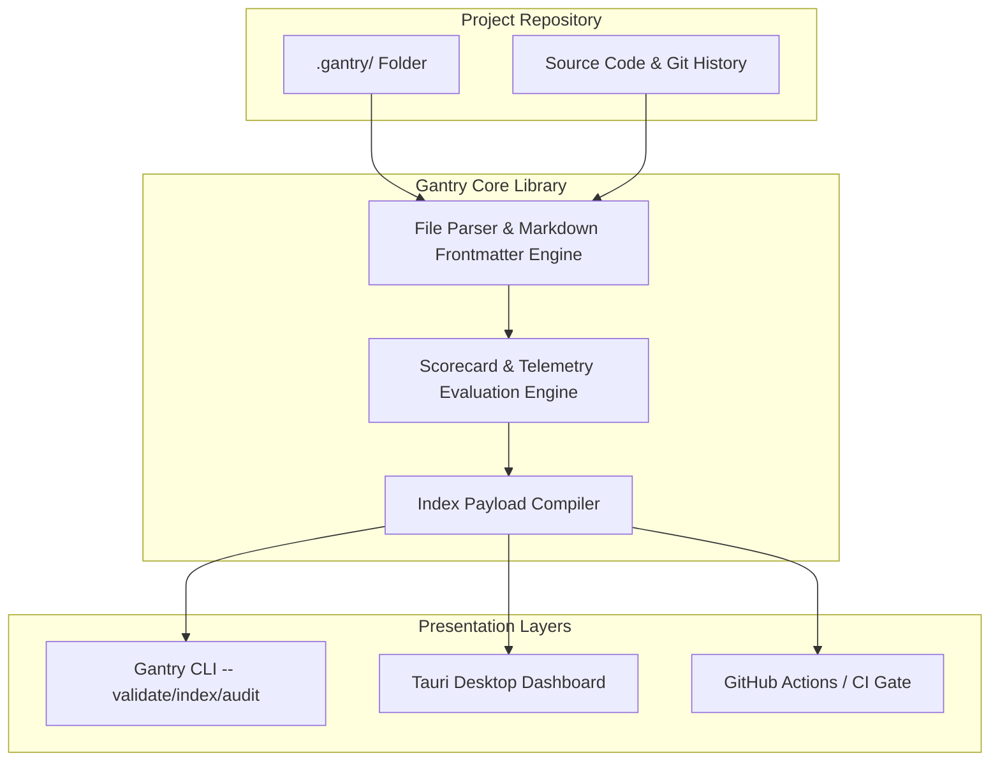
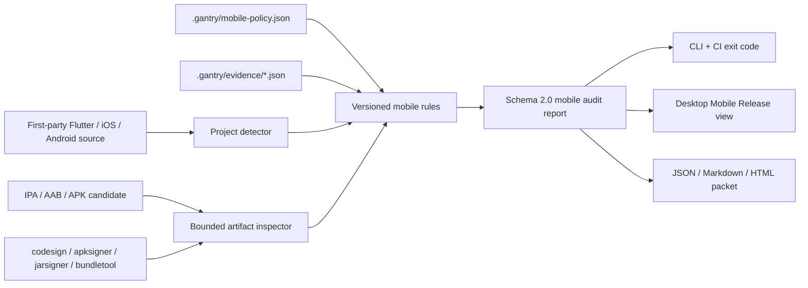

# Gantry Architecture Reference

This document outlines the core architecture of Gantry, its current implementation structure, data flow, and the proposed module boundaries for decoupling the codebase in future hardening releases (`0.4.0+`).

---

## 1. Core Architecture Philosophy

Gantry is a **local-first, declarative release gate and launch control room**. Unlike traditional hosted release management tools, Gantry operates entirely on top of your existing source control:

This repository is the Gantry Community runtime. It needs no Gantry account and does not
transmit release data to any hosted service.

- **Vault-Backed State (.gantry/)**: All release criteria, metadata, waivers, and evidence are stored as flat files (Markdown with frontmatter, or structured JSON) inside a `.gantry/` directory in the repository.
- **Git-Integrated Identity**: Blocker verify times, checklists, and evidence are linked to Git commits, committers, and branch history.
- **Stateless Analysis Engine**: The core library parses the vault, evaluates the scorecard and gates, processes external telemetry (e.g. Sentry/Datadog), and produces a unified, read-only launch payload (`IndexPayload`).
- **Dual Interface**: The stateless payload can be outputted by the CLI (for CI gates, PR comments, and scripting) or consumed by the Tauri Desktop application (for developer/release lead dashboards).



---

## 2. Existing Monolithic Architecture (`gantry-core`)

Currently, `gantry-core` contains a single high-surface-area entrypoint file `src/lib.rs` accompanied by helper modules:
- `src/lib.rs`: The main orchestration hub, containing `compile_launch_index_for_environment`, schema validation logic, markdown parsers, and all unit tests.
- `src/snapshot.rs`: Handles historical snapshot diffing, trend analysis, and Git commit metadata extraction.
- `src/graph.rs`: Constructs the impact and dependency graph linking blockers to affected source code and tests.
- `src/notify.rs`: Compiles transitions and formats Slack/digest notifications.
- `src/telemetry.rs`: Connects to Sentry/Datadog APIs and processes observed metrics against rules.
- `src/release.rs`: Owns durable workflow releases, immutable candidate identities,
  local storage, and hash-chained release events under `.gantry/releases/<release-id>/`.
- `src/mobile.rs` plus `src/mobile/rules.rs`: Independent mobile project/artifact scanner,
  evidence reconciliation, decision engine, report renderer, and declarative versioned
  rule registry.

### Durable release workflow storage

Generated readiness manifests remain `.gantry/releases/<version>.json`. Stateful
workflow releases use directories, so both contracts can coexist:

```text
.gantry/releases/
├── 2.6.0.json                  # legacy/generated readiness manifest
└── REL-1A2B3C4D5E/
    ├── release.json            # lifecycle head and active candidates
    ├── events.jsonl            # ordered SHA-256 event chain
    ├── candidates/
    │   └── CAN-6F7E8D9C0B.json # immutable artifact identity and Git binding
    ├── audits/
    │   └── AUD-1029384756.json # compact decision and report identity
    ├── evidence/
    │   └── LNK-5647382910.json # candidate/finding link to global EVI record
    ├── resolutions/
    │   └── RES-0192837465.json # accountable human workflow state
    ├── decisions/
    │   └── DEC-9182736450.json # candidate/audit-bound approval or rejection
    ├── waivers/
    │   └── WAV-8273645019.json # expiring accepted risk for an exact finding
    ├── packets/
    │   ├── PKT-A1B2C3D4E5.json # canonical content-addressed packet
    │   ├── PKT-A1B2C3D4E5.md   # human-readable rendering
    │   └── PKT-A1B2C3D4E5.html # standalone shareable rendering
    └── reports/
        └── AUD-1029384756.json # canonical schema-2 mobile audit report
```

The core owns serialization and verification. CLI and future desktop/hosted surfaces
call the same `ReleaseStore` API rather than editing these files directly. Loading a
release verifies its event chain plus every stored report fingerprint and binding.

Multi-file mutations use a recoverable transaction journal under `.gantry/transactions/`.
Every operation captures the expected event-head hash, stages checksummed bytes, acquires
a cross-process vault commit lock, rejects a stale writer, publishes child records and the
event log before `release.json`, syncs files and parent directories, and removes the journal
only after the commit is durable. `gantry vault check --repair` rolls a complete journal
forward after an interrupted process; incomplete unpublished staging directories are safe
to remove. Readers automatically recover a pending complete journal before verification.

Release evidence remains in the existing `.gantry/evidence/` collection so the mobile
engine consumes one evidence contract; the release-local link adds candidate, audit,
finding, actor, and payload-digest integrity.

Decisions are exact active-audit claims rather than mutable flags. An audit or candidate
change removes the affected decision and waivers from the active indexes but retains the
records and events. Loading cross-checks every record against the candidate, audit,
report fingerprint, policy digest, and matching hash-chained event. Waivers remain
visible after expiry and do not participate in deterministic rule evaluation.

The desktop command layer exposes release list/load, report, candidate binding, audit,
evidence, resolution, waiver, packet, diff, and decision methods as thin asynchronous
Tauri adapters. File parsing, artifact hashing, identity validation, approval/expiry
rules, event creation, and persistence stay in `gantry-core`; the browser layer receives
verified serializable records and never edits workflow JSON directly. Finding actions
join the canonical report to its active audit by fingerprint before the core accepts a
candidate-scoped record.

Long desktop audits use cooperative cancellation. The UI supplies an opaque request ID;
the Tauri adapter keeps only an in-memory cancellation token and the core checks it between
audit phases, during streamed artifact hashing, and while scanning archive limits. The
frontend validates native and demo payloads through schema-versioned runtime guards, while
generated TypeScript declarations are checked against the published JSON Schemas in CI.

The release portfolio is a disposable projection over fully verified `ReleaseView`
records. `gantry-core` derives owner, stage, age, active-platform audit totals, automated
decision, accepted risk, expiry pressure, next action, and review-queue classification.
Evidence expiry is considered only when its link still matches the active candidate and
audit, preventing superseded evidence from creating false portfolio alerts.
The CLI, Tauri adapter, and desktop cockpit serialize that one projection; JavaScript does
not recalculate authority for native records. A corrupt release therefore fails the
portfolio instead of disappearing from management view or being treated as healthy.

Packets are derived artifacts and do not add mutable release events. The packet digest
is calculated with identity fields blank, then becomes the stable `PKT-*` ID. Verification
rechecks the digest, event chain/head, every report fingerprint and policy digest, and
the recorded audit decision. Candidate diffs are computed from verified stored records;
they never compare unverified artifact bytes or infer finding resolution without audits.
The Markdown/HTML representations prepend a concise handoff summary derived from those
verified packet fields; it is presentation, never a second source of release authority.

CI uses verified idempotency rather than trusting a remote cache as workflow state.
`ensure_release` reopens and verifies an existing version, `ensure_candidate` reuses only
matching artifact kind/SHA/size/platform/Git identity, and `audit_reusing_unchanged`
re-evaluates the candidate before reusing an audit with the same report fingerprint and
policy digest. Changed inputs take the normal append-only path and invalidate stale
decisions. The GitHub Action then publishes the deterministic packet as a derived
artifact; cross-run authoritative history must come from the repository or another
trusted, subsequently verified restore step.

The optional derived audit cache lives under `.gantry/cache/mobile/` and is ignored by
Git. Its SHA-256 key covers Git commit, artifact SHA/size/extension, Gantry version,
report schema, policy digest, and a digest of the installed platform authority-tool
executables. Source dirt outside generated release/cache/report paths disables caching.
Entries repeat their full identity and canonical report; a hit requires identity equality
plus report fingerprint, artifact, policy, tool, and Git verification. A malformed entry
is treated as a miss and replaced. No cache entry contains or authorizes human decisions,
waivers, resolutions, or event history.

Published contract versions are indexed by `schemas/schema-manifest.json`; the companion
`schemas/README.md` defines exact-version fail-closed readers and copy-on-write migration
requirements. This keeps future migration behavior reviewable before writers change.

Redacted diagnostic generation lives in `gantry-core::support`, so the CLI and desktop
invoke one implementation. It intentionally projects only runtime/version, vault-health,
release-stage counts, policy presence, and authority-tool availability; source names and
contents, artifacts, credentials, evidence payloads, and actors never enter the bundle.

### Mobile release data flow

The mobile engine can run before a general vault exists. It does not build or submit the
application, but it invokes installed read-only platform authority tools for artifact
verification and metadata enrichment:



Artifact output records Git state, candidate SHA-256, effective-policy digest, report
fingerprint, signature-verifier output, and target-specific finding identities. Platform
values that cannot be decoded safely are marked unavailable; the scanner never guesses
store acceptance or signing authority.

The production refactor has started with the declarative `rules` module. Later internal
extractions can move `model`, `policy`, `project`, `artifact`, `evidence`, and `report`
behind the same schema 2.0 facade. Those are maintainability changes, not report-contract
changes.

### Challenges of the Monolith
- **High Cognitive Load**: `lib.rs` is over 8,000 lines long, housing validation logic, serialization structures, and test suites together.
- **Tight Coupling**: File parsing, schema checks, and readiness calculations share state and local functions, making it harder to add new policy types.

---

## 3. Proposed Modular Decoupling (`0.4.0+` Plan)

To enable enterprise-grade scalability, Gantry will extract `lib.rs` into specialized, isolated modules. The proposed module boundaries are:

```
crates/gantry-core/src/
├── lib.rs              # Thin API facade & orchestrator
├── parser/             # Frontmatter and markdown parsing
│   ├── mod.rs
│   └── markdown.rs
├── validation/         # Structural & schema validation checks
│   ├── mod.rs
│   └── schema.rs
├── policy/             # Policy engine & scorecard evaluation
│   ├── mod.rs
│   ├── scorecard.rs
│   └── telemetry.rs
├── storage/            # Data models and structures
│   ├── mod.rs
│   ├── waivers.rs
│   └── evidence.rs
├── graph/              # Dependency & code impact graph
│   └── mod.rs
└── notify/             # Notification payloads and Slack digest
    └── mod.rs
```

### Module Boundary Specifications

### A. Parser (`gantry_core::parser`)
- **Responsibility**: Low-level reading of markdown files, parsing YAML/JSON frontmatter, extracting checklist items, and finding wiki/cross-document links.
- **Boundary**: Does not know about "readiness" or "scorecards". Takes raw strings/files and outputs syntax trees or key-value structures.

### B. Validation (`gantry_core::validation`)
- **Responsibility**: Checks if files conform to their JSON schemas (`schema/*.schema.json`), matches markdown frontmatter fields, and handles ignored/remediated tasks.
- **Boundary**: Produces lists of structured `GantryIssue` objects. Exits early (returns `Err`) if core files (`config.json`, `waivers.json`) are corrupt.

### C. Policy (`gantry_core::policy`)
- **Responsibility**: Evaluates the release rules:
  - telemetry criteria (e.g. Sentry crash rates).
  - scorecard predicate checks (e.g. QA completion ratios).
  - stakeholder sign-off status.
- **Boundary**: Computes the readiness status (`Go` / `No-Go` / `At Risk`) and readiness scores.

### D. Storage (`gantry_core::storage`)
- **Responsibility**: Manages the life cycle of evidence records (`evidence/`), active/expired waivers (`waivers.json`), and release manifest histories (`releases/`).
- **Boundary**: Serves as the database abstraction layer over the flat-file vault.

### E. Graph (`gantry_core::graph`)
- **Responsibility**: Traverses source file lists and maps open blockers to related source files, test suites, and impact rings.
- **Boundary**: Consumes Git history and outputs node-edge JSON payloads.

---

## 4. Compile & Validation Data Flow

Every validation or index compilation run follows a strict top-down data flow sequence:

1. **Load Phase**: Load `.gantry/config.json` and `.gantry/tasks.md`.
2. **Schema Phase**: Validate structural files (`waivers.json`, `scorecard.json`, `store_metadata/*.json`) against their schemas.
3. **Parse Phase**: Read all blockers (`blockers/*.md`) and QA suites (`qa/*.md`), parsing metadata and checkboxes.
4. **Link Phase**: Validate internal links, verify referenced source files exist in the project, and construct the impact graph.
5. **Evaluation Phase**: Match active waivers to suppress blockers, evaluate observed telemetry, check scorecard predicates, and calculate final readiness scores.
6. **Output Phase**: Compile into `IndexPayload` and write to `.gantry/index.json`.
